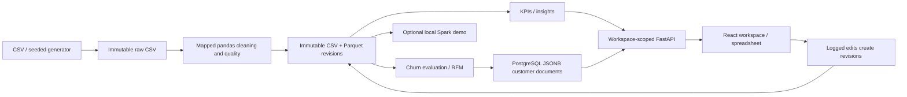

github : https://github.com/0xNived/RetailPlus

# RetailPlus

## Product information

RetailPlus is an enterprise data platform for importing, cleaning, analyzing, and using business data in dashboards and ML workflows. It supports structured, semi-structured, and unstructured inputs through a staged rollout.

### Initial release: source files

The first release will start with the source-file formats represented in the product UI:

| Format | Extension | Initial purpose |
| --- | --- | --- |
| CSV | `.csv` | Tabular business and product data |
| Excel | `.xlsx` | Spreadsheet imports |
| PDF | `.pdf` | Invoices, reports, and documents |
| Docs | `.docx` | Word business documents |
| Images | `.png` | Image-based source material |
| JPEG | `.jpg`, `.jpeg` | Image-based source material |

These formats are the planned first implementation scope; support will be marked complete only after upload, extraction/parsing, validation, error handling, and tests are delivered.

### Supported and planned input formats

| Priority | Format | Extension | Typical use | Recommendation |
| --- | --- | --- | --- | --- |
| 🟢 P0 | CSV | `.csv` | Customer records, products, company datasets | **Essential** |
| 🟢 P0 | Excel | `.xlsx`, `.xls` | Business data, spreadsheets | **Essential** |
| 🟢 P0 | JSON | `.json` | APIs, nested data, company records | **Essential** |
| 🟢 P0 | Plain Text | `.txt` | Unorganized lists, raw text | **Essential** |
| 🟢 P0 | Paste Input | Direct text | Users paste messy data | **Essential** |
| 🟡 P1 | JSON Lines | `.jsonl`, `.ndjson` | Large datasets, AI pipelines | Highly recommended |
| 🟡 P1 | PDF | `.pdf` | Invoices, reports, company documents | Recommended |
| 🟡 P1 | Word | `.docx` | Reports, descriptions, business records | Recommended |
| 🟡 P1 | XML | `.xml` | Enterprise systems, data exports | Recommended |
| 🟡 P1 | HTML | `.html` | Website exports, scraped content | Recommended |
| 🔵 P2 | Parquet | `.parquet` | Large analytical datasets | Later |
| 🔵 P2 | SQL | `.sql` | Database exports | Later |
| 🔵 P2 | Database | PostgreSQL, MySQL, SQLite | Direct database imports | Later |

## Planned product workflow

```text
                 DATA INPUT
                     │
                     ▼
              DATA INGESTION
           (CSV, Excel, API, DB)
                     │
                     ▼
             DATA PROFILING
       (Understand data & detect issues)
                     │
                     ▼
              DATA CLEANING
       (Duplicates, missing values,
        formatting, invalid records)
                     │
                     ▼
           DATA TRANSFORMATION
       (Normalize, structure, categorize,
        merge and engineer features)
                     │
                     ▼
              DATA STORAGE
           (Database / Warehouse)
                     │
             ┌───────┴────────┐
             ▼                ▼
        ANALYTICS         ML / AI MODEL
      (KPIs, trends,      (Predictions,
       statistics)         classifications)
             │                │
             └───────┬────────┘
                     ▼
                DASHBOARD
          (Charts, insights, reports)
                     │
                     ▼
              EXPORT / ACTION
          (CSV, PDF, API, alerts)
```

This workflow is planned architecture. Initial development starts with P0 ingestion, profiling, cleaning, transformation, database storage, and dashboard-ready analytics; ML, advanced exports, and later input sources follow in staged releases.

## Working CSV organizer

The workspace now saves editable datasets, immutable CSV/Parquet versions and provenance. RetailPlus includes a seeded retail generator, saved field mapping, quality reports, filtered retail analytics, evaluated churn models, RFM segments and customer documents in PostgreSQL JSONB. MongoDB and local JSON customer fallbacks are not used. The format tables above remain a roadmap; CSV is the implemented ingestion format.

The full nine-stage logical agent workflow and its phased delivery plan are in [the agent workflow](docs/agent-workflow.md).

## Run locally

Requires Node.js/npm, Python 3.11+ and PostgreSQL. Create the local database before migrations. For a new environment, copy `.env.example` to `.env`; configure database URLs, JWT secret, admin email/password and frontend origin. Preserve an existing `.env` and keep credentials private.

```powershell
npm install
npm run db:generate
npm run db:deploy
npm run db:seed
python -m venv .venv
.\.venv\Scripts\Activate.ps1
python -m pip install -r requirements.txt
```

Activate `.venv` in each backend terminal before running Python commands. If PowerShell blocks activation, use `.\.venv\Scripts\python.exe` directly. Root `requirements.txt` includes the API service manifest; Spark remains optional in `services/api-service/requirements-spark.txt`.

Start each service in a separate terminal:

```powershell
npm run api:dev
npm run dashboard:dev
```

Open http://localhost:5173. API documentation: http://localhost:8000/docs. Use one API process for the local background-job runner.

## Retail demo

1. Sign in, choose a workspace, then **Datasets → Add dataset**.
2. Upload CSV or **Generate and run pipeline** with 10K / 50K / 100K transactions (seed 42). Generated data includes customers, SKUs, stores, country/city/state/postal codes and deliberately messy/invalid rows. Generated amounts use INR.
3. Confirm retail column mapping. Use a line amount or price × quantity; unmapped quantity defaults to one. An unchanged mapping preserves trained output; changing it invalidates models.
4. Review the compact **Data organized** report, edit the sheet, and download CSV/change logs or immutable CSV/Parquet revisions. The value bar edits text; it is not a formula engine. CSV does not preserve visual formatting.
5. **Analytics** has Dashboard / Insights / Reports tabs with shared filters. **Predictions** has measured model metrics, current risk probabilities and a simple monthly forecast. **Customers** has profiles, nested purchase history, JSONB document filters, segments and high-risk exports.
6. Navigation focuses on Home, Datasets, Analytics, Customers, Predictions and Assistant (planned). The More sidebar group was removed by request. Prior simulation/learning/demo source and APIs remain available for the submission; Spark can be invoked through the FastAPI docs rather than a sidebar page.

Analytics uses coordinated interactive sales/category/order/customer/location cards, shared filters and product tables. Customers provides overview metrics, a searchable/sortable directory, segment exploration and a profile drawer with purchase history and churn context. These views are split into focused modules under `apps/admin-dashboard/src/retail/` with reusable chart/card components, types and styles. Summary cards describe the full scored customer dataset; directory filters scope the list.

Customer health uses direct outlook labels: Likely to return (Low risk), Check in soon (Medium), and May not return (High). These are model estimates, not guarantees. Analytics → Products shows a searchable next-month unit baseline from the three calendar months before the final observed month, excluding the partial final month. It uses active filters and needs mapped product/SKU plus enough history; it is not an evaluated forecast model.

Workspace switching/creation is available directly in the sidebar dropdown. Changing workspace clears the previous dataset/view state. The redesigned landing page uses an explicitly labeled illustrative fixture, not account data. The transparent cart-plus brand asset and category icon approach are documented in [brand assets](docs/brand-assets.md).

First measured local 10K pipeline: 5.67 seconds, including generation, cleaning/Parquet, analytics, model training and customer storage. This is an observation on the development machine, not a guarantee for other hardware.

## Implemented architecture



PostgreSQL stores workspaces, metadata/profiles, mappings, revision catalogs, jobs, models and customer JSONB documents. Python uses psycopg SQL at runtime; Prisma owns migrations and database tooling.

- `data/raw/`: exact uploaded/generated source bytes, never modified by cleaning/edits.
- `data/clean/<dataset>/`: immutable CSV revisions.
- `data/lake/<dataset>/`: matching Parquet snapshots and successful Spark run evidence.
- `data/uploads/`: compatibility sources, mutable sheet cache, styles and legacy edit logs. The committed version catalog is authoritative for sheet values.

An advisory lock serializes dataset edits. Each revision has a checksum and provenance. Changes invalidate model output/customer documents. Pipeline stages show actual queued/running/done/failed/skipped state and measured duration; running stages use indeterminate progress. PostgreSQL job state survives navigation. API restarts mark interrupted local jobs failed for retry; this is not a durable distributed queue. Files written before a failed database commit can remain orphaned; automatic file retention/garbage collection is not implemented.

## Calculations and limits

- CSV limit: 50 MB, 100,000 rows, 100 columns. Other input formats remain planned. PDF export produces reports; PDF ingestion is not implemented.
- Analytics requires mapped date and amount (or price). **Churn needs customer ID, date and amount**, at least 180 days of valid history, 30 customers and five examples of each class. Missing data produces an explanation, never invented metrics.
- Revenue uses valid completed lines. Orders are distinct mapped order IDs or row keys when absent. AOV = completed revenue / completed distinct orders. Cancellation rate = distinct cancelled / all valid orders. Mixed statuses within one order need a more detailed business policy.
- Invalid prices/amounts, nonpositive quantities, malformed/future dates and unknown statuses are retained and excluded from business math. Median financial fills are marked and excluded too. Key fills require exactly one known value. Statistical fills are logged; IDs/postal codes stay strings. Mostly-missing columns are flagged.
- Quality = mean of completeness, uniqueness and validity percentages. A high score is not a guarantee of semantic correctness. The report describes the most recent cleaning run; rerun after editing. Fuzzy duplicate matching is bounded and skipped above 500 candidate values.
- Churn cutoff = latest valid date minus 90 days. Features use dates at/before cutoff; labels use completed purchases after cutoff through the next 90 days. Scaling/model fitting use only training customers. Both models share a stratified 25% holdout with seed 42. Current probabilities use current features with the fitted forest; metrics remain historical holdout results. Single-cutoff validation is not prospective validation.
- RFM uses scaled log features and KMeans (k=4). Cluster labels are ranked descriptions, distinct from predicted risk. Cancellation insights describe associations, not proven causes. Inventory is explicitly simulated. Retention insights use the full selected dataset, independently of dashboard filters.
- No currency conversion, tax or refund accounting is inferred. Hadoop/Kafka/cloud are conceptual; live arrivals are simulated. Assistant, dark mode, 500K processing and multi-format ingestion remain unimplemented.

## Optional real Spark demo

```powershell
python -m pip install -r services/api-service/requirements-spark.txt
```

Use Java 17 or 21; set `SPARK_JAVA_HOME` in `.env` if Java is not on PATH, then restart the API. See [Apache Spark 4.1 requirements](https://spark.apache.org/docs/4.1.1/). `POST /retail/spark?dataset_id=...` runs an isolated Spark worker against the selected cleaned Parquet revision: DataFrame groupBy/sum, RDD map/reduceByKey and Spark SQL. All three actual outputs and job timing are returned; successful execution is recorded against the dataset revision. Dependency/worker errors are not reported as successful runs. Use the authenticated FastAPI documentation; the learning pages are no longer in the sidebar.

## Verify

```powershell
npm run dashboard:build
npm run db:generate
cd services/api-service
python -m unittest discover -s tests -v
```

Tests require the configured local PostgreSQL/admin. They use isolated test workspaces and cover CSV behavior, generator reproducibility, quality/invalid retention, mapped KPI math and filters, churn confusion-matrix metrics and date boundaries, JSONB filtering, reports, raw/version preservation, failed jobs and workspace isolation.

Browser verification screenshots are local under ignored `output/playwright/`: `analytics.png`, `predictions.png`, `customers.png` and `mobile.png` when captured. Generated verification artifacts and credentials are not committed. Viva preparation is in [VIVA_NOTES.md](VIVA_NOTES.md).

## Current Indian retail demo

Generate a fresh fictional dataset through today's date in India:

```powershell
python scripts/generate_retail_demo.py --rows 50000
```

Optional: `--seed 42`, `--end-date 2026-10-29`, `--output path.csv`, or `--messy` to exercise cleaning. Defaults to a clean CSV under ignored `data/raw/`; existing files are never overwritten. Supports 100 to 100,000 rows. An explicit end date and seed reproduce the same output. The in-app 10K/50K/100K pipeline uses the same generator with intentional cleaning examples.

Includes fictional Indian names, explicitly generated Male/Female fields, consistent customer locations and avatar seeds, 102 product SKUs with marketplace-style titles, INR prices, and recent completed orders through the chosen date. Product prices are illustrative, email addresses use `example.test`, and profiles are fictional. Gender is available for directory filtering and is not used in churn features. Avatars are local SVG placeholders with initials fallback ([asset notes](docs/brand-assets.md)). Currency-aware displays use Indian number grouping and ₹ for INR; mixed-currency totals are rejected rather than silently combined. Import the CSV in Datasets and run the retail pipeline to build customer profiles and models.

## Product planning and dataset removal

Predictions opens on **Product planning**, with server-side product/SKU search, category filtering and pagination across all products. Select a product for next-month demand units, a revenue plan at recent realized prices, actual month-on-month sales momentum, cancellation/return rates, ABC revenue classification and monthly history. Customer retention reuses the named customer directory; Model evaluation explains the existing churn models and their measured metrics.

Product plans compare a trailing 3-month moving average against a last-complete-month baseline. First and final observed months are conservatively excluded, including when a product is newly introduced; missing interior sales months after introduction are treated as zero, assuming complete source coverage. The target is the month after the final observation month. Rolling checks use that same two-month horizon, with up to six past targets. With at least three checks, the method with lower MAE is used; otherwise the moving average remains the default. SKU identity survives product-title changes. Search has no top-200 product cap.

- **MAE:** mean absolute unit error. **WAPE:** summed absolute unit error / summed actual units; undefined for zero total actual demand. **Bias:** mean predicted minus actual units; positive means overforecasting. Method selection and reporting use the same historical checks, so these are not independent or prospective validation.
- **Revenue plan:** projected units (rounded to one decimal) times the last three complete months' completed revenue / units. Prices and promotions are not predicted; this is revenue, not profit.
- **ABC:** rank recent completed revenue; A contains the first 80%, B the next 15%, C the remainder. The product crossing a cutoff stays in the preceding class. This is revenue-based prioritization, not margin classification.
- **Stock calculator:** user supplies actual on-hand units, incoming units, supplier lead days and buffer coverage days. Suggested purchase = max(0, ceil(monthly demand / 30 * (lead + buffer days)) - on hand - incoming). Inputs are non-negative whole numbers; lead + buffer cannot exceed 365 days. Buffer coverage is an assumption, not calculated statistical safety stock. Calculator inputs are session-only and do not update an inventory database.

Delete a saved dataset from its list-row trash button or its open sheet. The confirmation names the dataset and defaults focus to **Keep dataset**. `DELETE /datasets/{id}` checks current workspace membership, serializes against pipeline creation, blocks deletion while a workspace pipeline runs, and cascades dataset profiles, versions, models, customer documents and job records. It removes only that dataset's UUID-owned source copy, caches, CSV and Parquet files; external originals and generator exports stay intact. Unreferenced import/source metadata is removed too. The active selection resets, and dataset lists refresh on re-entry.

Files are staged under ignored `data/.deleting/<operation UUID>` before the database transaction commits and restored on ordinary transaction/storage failure. A private `manifest.json` maps staged files for manual recovery after a process/OS crash: if the dataset still exists in PostgreSQL, restore staged files to their source paths; otherwise finish purging the staged files. There is no automatic crash-recovery worker. Keep the documented single-API-process deployment for this local project.
